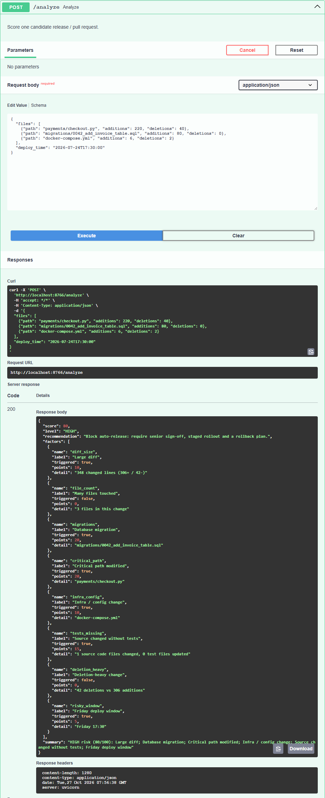

# ReleaseGuard — Deployment Risk & Regression Analyzer

[](https://github.com/tanviwadgaonkar/releaseguard/actions/workflows/ci.yml)

**Status:** implemented and tested (46 tests). The CLI scores real GitHub pull requests. The risk weights are hand-set and have **not** been validated against real incident data. The Docker image is built and smoke-tested in CI. Not deployed.

**Explainable deployment-risk scoring.** Give ReleaseGuard the files changed
in a release (or a GitHub PR), and it returns a 0–100 risk score where **every
point is traced to an auditable factor** — changed-code size, database
migrations, critical-path modifications, missing test updates, infra/config
changes, deletion-heavy diffs and risky deploy windows.

```
GitHub PR (REST API) ─┐
JSON request ─────────┼─► path classifier ─► factor rules (8) ─► score + level + recommendation
POST /analyze ────────┘   (test / source /        │
                           migration / infra /    each factor: triggered? points, evidence
                           critical)
```



*`POST /analyze` with `examples/sample_pr_high_risk.json`, run locally through the interactive docs at `/docs`. Every point in the 80/100 score maps to a factor with its evidence.*

## Why explainable?

A single opaque number can't gate a release. Every ReleaseGuard factor
returns *what triggered, how many points it added, and the evidence*
(which files), so a reviewer can agree or override with full context.

## API

```bash
uvicorn app.main:app --reload          # interactive docs at /docs

curl -X POST http://localhost:8000/analyze \
  -H "Content-Type: application/json" \
  -d @examples/sample_pr_high_risk.json
```

Response (trimmed):

```json
{
  "score": 80,
  "level": "HIGH",
  "recommendation": "Block auto-release: require senior sign-off, staged rollout and a rollback plan.",
  "factors": [
    {"name": "migrations", "label": "Database migration", "triggered": true,
     "points": 20, "detail": "migrations/0042_add_invoice_table.sql"},
    {"name": "critical_path", "label": "Critical path modified", "triggered": true,
     "points": 20, "detail": "payments/checkout.py"}
  ],
  "summary": "HIGH risk (80/100): Large diff; Database migration; ..."
}
```

### Score a real pull request

```bash
python -m app.cli --markdown github pallets/flask 6168
```

```
### ReleaseGuard: MEDIUM risk (38/100) — pallets/flask#6168
| ⚠️ | Large diff              | 10 | 500 changed lines (67+ / 433-) |
| ⚠️ | Many files touched      |  8 | 12 files in this change |
| ⚠️ | Infra / config change   | 10 | .github/workflows/tests.yaml |
| ·  | Source changed w/o tests|  0 | 3 source code files changed, 4 test files updated |
| ⚠️ | Deletion-heavy change   | 10 | 433 deletions vs 67 additions |
```

The CLI pages through GitHub's PR-files API (up to its 3,000-file limit), scores renamed files under both their old and new paths (counted once for the size factors), and exits with code 2 on HIGH so it can gate a pipeline. `GITHUB_TOKEN` is optional for public repos. This repo's own CI runs it on every pull request and writes the report to the job summary.

## Risk factors

| Factor | Points | Triggered when |
|---|---|---|
| Large diff | 10–20 | > 150 / > 500 changed lines |
| Many files touched | 8–15 | > 8 / > 20 files |
| Database migration | 20 | `migrations/`, `alembic/`, `*.sql` |
| Critical path modified | 20 | a directory or file stem named `auth`, `payment(s)`, `billing`, `security`, `core` (configurable) |
| Infra / config change | 10 | Dockerfile, compose, `*.yml`, `.env`, terraform, k8s, helm |
| Source changed without tests | 15 | code files changed (by extension), zero test files updated |
| Deletion-heavy change | 10 | deletions > 100 and > 2× additions |
| Friday deploy window | 5 | deploy time falls on a Friday |

Levels: **LOW** < 30 ≤ **MEDIUM** < 60 ≤ **HIGH** — each with a concrete
release recommendation.

## How files are classified

Every factor depends on recognising what a path *is*, so `app/classify.py` is tested on its own (`tests/test_classify.py`):

- **Critical** matching is by path segment, not substring. `core` flags `core/settings.py` and `api/core.py` but not `ml/score.py`; `auth` flags `auth/login.py` but not `docs/author.md`. Custom entries are case-insensitive, and an entry containing `/` is a path prefix.
- **Tests:** `tests/`, `test/`, `__tests__/`, `spec/`, `test_*.py`, `*_test.py`, `*_test.go`, `*.test.(js|ts|jsx|tsx)`, `*.spec.(…)`, `conftest.py`.
- **Source code** is recognised by extension (`.py`, `.ts`, `.go`, `.java`, …), so a README-only change no longer reports "source changed without tests".

## Run the tests / Docker

```bash
pip install -r requirements-dev.txt
python -m pytest -q          # 46 tests

docker build -t releaseguard .
docker run -p 8000:8000 releaseguard
```

## Deployment

The Docker image listens on `$PORT` (default 8000) and has a `/health` healthcheck. `render.yaml` is a Render Blueprint for the free tier: in Render, choose **New → Blueprint** and select this repo. CI builds the image and smoke-tests `/health` and `/analyze` on every push. There's no public demo yet.

## Known limitations

- The factor weights and thresholds are hand-chosen, not learned from incident data; the score ranks changes for review and isn't a probability of failure.
- File classification is by path and extension; it doesn't read diffs, so a risky one-line config change scores like a harmless one.
- "Friday deploy window" uses the timestamp as given, with no timezone or holiday calendar.
- The CLI writes the report to stdout and the CI job summary; it doesn't comment on the PR yet.

## Roadmap

- Comment the report on the PR (today it goes to the CI job summary)
- Historical calibration: learn factor weights from past incident data
- Regression-test selection: map changed files to the test subset to re-run

## Stack

Python · FastAPI · Pydantic v2 · pytest · Docker · GitHub Actions
