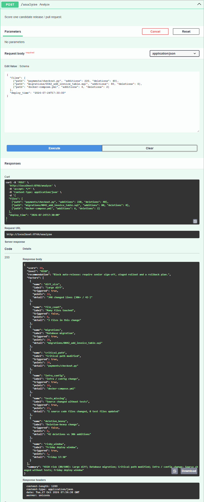

# ReleaseGuard — Deployment Risk & Regression Analyzer

[](https://github.com/tanviwadgaonkar/releaseguard/actions/workflows/ci.yml)

**Status:** implemented and tested (92 tests). The CLI scores real GitHub pull requests. The risk weights are hand-set and have **not** been validated against real incident data. The Docker image is built and smoke-tested in CI. Live demo (free tier, so the first request after idle takes about a minute): https://releaseguard-rhhp.onrender.com/docs.

**Explainable deployment-risk scoring.** Give ReleaseGuard the files changed
in a release (or a GitHub PR), and it returns a 0–100 risk score where **every
point is traced to an auditable factor** — changed-code size, database
migrations, critical-path modifications, missing test updates, infra/config
changes, deletion-heavy diffs and risky deploy windows.

```
GitHub PR (REST API) ─┐
JSON request ─────────┼─► path classifier ─► factor rules (8) ─► score + level + recommendation
POST /analyze ────────┘   (test / source /        │
                           migration / infra /    each factor: triggered? points, evidence
                           critical)
```



*`POST /analyze` with `examples/sample_pr_high_risk.json`, run locally through the interactive docs at `/docs`. Every point in the 80/100 score maps to a factor with its evidence.*

## Why explainable?

A single opaque number can't gate a release. Every ReleaseGuard factor
returns *what triggered, how many points it added, and the evidence*
(which files), so a reviewer can agree or override with full context.

## API

```bash
uvicorn app.main:app --reload          # interactive docs at /docs

curl -X POST http://localhost:8000/analyze \
  -H "Content-Type: application/json" \
  -d @examples/sample_pr_high_risk.json
```

Response (trimmed):

```json
{
  "score": 80,
  "level": "HIGH",
  "recommendation": "Block auto-release: require senior sign-off, staged rollout and a rollback plan.",
  "factors": [
    {"name": "migrations", "label": "Database migration", "triggered": true,
     "points": 20, "detail": "migrations/0042_add_invoice_table.sql"},
    {"name": "critical_path", "label": "Critical path modified", "triggered": true,
     "points": 20, "detail": "payments/checkout.py"}
  ],
  "summary": "HIGH risk (80/100): Large diff; Database migration; ..."
}
```

### Score a real pull request

```bash
python -m app.cli --markdown github pallets/flask 6168
```

```
### ReleaseGuard: MEDIUM risk (38/100) — pallets/flask#6168
| ⚠️ | Large diff              | 10 | 500 changed lines (67+ / 433-) |
| ⚠️ | Many files touched      |  8 | 12 files in this change |
| ⚠️ | Infra / config change   | 10 | .github/workflows/tests.yaml |
| ·  | Source changed w/o tests|  0 | 3 source code files changed, 4 test files updated |
| ⚠️ | Deletion-heavy change   | 10 | 433 deletions vs 67 additions |
```

The CLI pages through GitHub's PR-files API (up to its 3,000-file limit), scores renamed files under both their old and new paths (counted once for the size factors), and exits with code 2 on HIGH so it can gate a pipeline. `GITHUB_TOKEN` is optional for public repos. This repo's own CI runs it on every pull request and writes the report to the job summary.

## Security and operations

- **API key (optional).** Set `RELEASEGUARD_API_KEY` and `POST /analyze` requires an `X-API-Key` header, compared in constant time. With the variable unset the service stays open, which is how it runs locally. `/health` and `/metrics` never need a key.
- **Input limits.** Request bodies are capped at 2 MB (`RELEASEGUARD_MAX_BODY_BYTES`), a request can list at most 10,000 files and 100 critical paths, and line counts are bounded.
- **One error format.** Every error returns `{"error": {"code", "message", "request_id", "details"}}`. Validation errors name the field but never echo the submitted value, and unexpected errors return a generic message while the traceback goes to the log.
- **Request IDs and logs.** Each response carries an `X-Request-ID` header, and each request writes one JSON log line with method, path, status and duration.
- **Metrics.** `GET /metrics` exposes `releaseguard_requests_total`, `releaseguard_request_duration_seconds` and `releaseguard_analyses_total` in the Prometheus format. The `path` label is the route template, so unknown URLs cannot create new series.

```bash
RELEASEGUARD_API_KEY=change-me uvicorn app.main:app
curl -X POST localhost:8000/analyze -H "X-API-Key: change-me" \
  -H "Content-Type: application/json" -d @examples/sample_pr_high_risk.json
curl localhost:8000/metrics
```

## Release-gate agent (human approval)

`POST /agent/runs` scores a change and has a small LangGraph agent propose one action. A LOW-risk change goes ahead and is logged. A MEDIUM or HIGH one **pauses** until a person decides, and nothing is executed before that decision.

```text
assess -> propose -(LOW)-> execute
             \-(MEDIUM/HIGH)-> approval_gate (pauses) -> record_decision -(yes)-> execute
                                                              \-(no)-> reject
```

```bash
curl -X POST localhost:8000/agent/runs -H "Content-Type: application/json" \
  -d @examples/sample_pr_high_risk.json          # -> status "awaiting_approval", proposed action
curl -X POST localhost:8000/agent/runs/<run_id>/decision -H "Content-Type: application/json" \
  -d '{"approve": false, "reviewer": "priya", "reason": "no rollback plan"}'
curl localhost:8000/agent/runs/<run_id>          # state plus the audit trail for the run
```

- **The proposal is a fixed policy**, not a language model: LOW marks the release ready, MEDIUM adds an extra reviewer, HIGH blocks auto-release and requests senior sign-off. These change the release pipeline, so only the harmless one runs on its own. A fixed policy keeps the agent predictable and testable.
- **A run is decided once.** A second decision, or a decision on a LOW run, returns 409. Simultaneous decisions are serialised so the action cannot run twice. Decisions are validated (reviewer required, lengths capped) before the run resumes.
- **Audit log.** Every step (`run_started`, `action_proposed`, `decision_recorded`, `action_executed` or `action_skipped`) is recorded with a timestamp, run ID and reviewer. Set `RELEASEGUARD_AUDIT_LOG=/path/audit.jsonl` to also append each event to a JSON-lines file.
- **Limits.** At most 1,000 runs may wait for a decision (`RELEASEGUARD_MAX_PENDING_RUNS`), then new runs get 429. The `releaseguard_agent_decisions_total` metric counts approvals, rejections and auto-approvals.

## Risk factors

| Factor | Points | Triggered when |
|---|---|---|
| Large diff | 10–20 | > 150 / > 500 changed lines |
| Many files touched | 8–15 | > 8 / > 20 files |
| Database migration | 20 | `migrations/`, `alembic/`, `*.sql` |
| Critical path modified | 20 | a directory or file stem named `auth`, `payment(s)`, `billing`, `security`, `core` (configurable) |
| Infra / config change | 10 | Dockerfile, compose, `*.yml`, `.env`, terraform, k8s, helm |
| Source changed without tests | 15 | code files changed (by extension), zero test files updated |
| Deletion-heavy change | 10 | deletions > 100 and > 2× additions |
| Friday deploy window | 5 | deploy time falls on a Friday |

Levels: **LOW** < 30 ≤ **MEDIUM** < 60 ≤ **HIGH** — each with a concrete
release recommendation.

## How files are classified

Every factor depends on recognising what a path *is*, so `app/classify.py` is tested on its own (`tests/test_classify.py`):

- **Critical** matching is by path segment, not substring. `core` flags `core/settings.py` and `api/core.py` but not `ml/score.py`; `auth` flags `auth/login.py` but not `docs/author.md`. Custom entries are case-insensitive, and an entry containing `/` is a path prefix.
- **Tests:** `tests/`, `test/`, `__tests__/`, `spec/`, `test_*.py`, `*_test.py`, `*_test.go`, `*.test.(js|ts|jsx|tsx)`, `*.spec.(…)`, `conftest.py`.
- **Source code** is recognised by extension (`.py`, `.ts`, `.go`, `.java`, …), so a README-only change no longer reports "source changed without tests".

## Run the tests / Docker

```bash
pip install -r requirements-dev.txt
python -m pytest -q          # 92 tests

docker build -t releaseguard .
docker run -p 8000:8000 releaseguard
```

## Deployment

The Docker image listens on `$PORT` (default 8000) and has a `/health` healthcheck. `render.yaml` is a Render Blueprint for the free tier: in Render, choose **New → Blueprint** and select this repo. CI builds the image and smoke-tests `/health` and `/analyze` on every push. The free-tier demo is at https://releaseguard-rhhp.onrender.com/docs.

## Known limitations

- Auth is one shared API key: no per-user keys, key rotation or rate limiting. For the same reason the agent's `reviewer` is a name the caller types, not a verified identity, and nothing stops the person who started a run from approving it. `/metrics` is unauthenticated, so in production keep it behind the platform's network controls.
- The factor weights and thresholds are hand-chosen, not learned from incident data; the score ranks changes for review and isn't a probability of failure.
- File classification is by path and extension; it doesn't read diffs, so a risky one-line config change scores like a harmless one.
- "Friday deploy window" uses the timestamp as given, with no timezone or holiday calendar.
- The agent's executor is simulated: it records what would have been done and calls no external system. Runs are held in memory and are lost on restart (the audit log file is not), so it runs on one process only.
- The CLI writes the report to stdout and the CI job summary; it doesn't comment on the PR yet.

## Roadmap

- Comment the report on the PR (today it goes to the CI job summary)
- Historical calibration: learn factor weights from past incident data
- Regression-test selection: map changed files to the test subset to re-run

## Stack

Python · FastAPI · Pydantic v2 · pytest · Prometheus metrics · Docker · GitHub Actions
